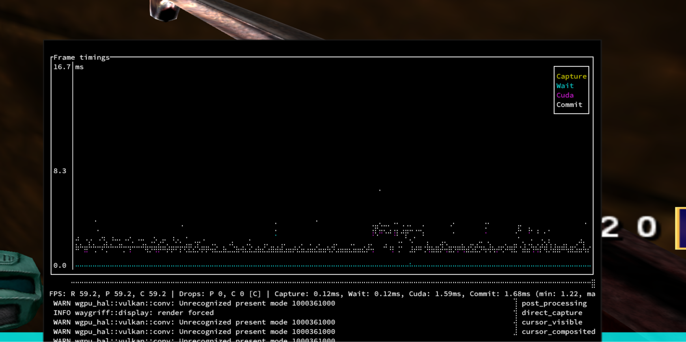

waygriff is a local display proxy.
It captures frames from an X11 session and displays them in a Wayland window on the same computer.
Mouse and keyboard inputs are forwarded in the other direction.

This is personal infrastructure, not a product.
I'm publishing it for entertainment purposes.

## why

I switched my PC's desktop session from the Nvidia card to the Ryzen iGPU to save on power costs and free up VRAM for ML stuff. Games use PRIME offload for rendering, like on a laptop.
Unfortunately, Mesa's Wayland Vulkan WSI is even jankier than Nvidia's.

- Mouse is not grabbed reliably.
  Depending on moon phase and Proton version, the pointer isn't confined at all or requires opening and closing the game menu.
- Floating game windows consistently pick the portrait 1440x2560 resolution from one of my side monitors regardless of xrandr --primary setting.
- Fullscreen doesn't work, whether initiated by Hyprland or the game.
  The window un-fullscreens itself immediately.

## why not

- **gamescope**? Fails with some DRM modifier nonsense. Valve maintains gamescope for the Steam Deck and it never worked right when an Nvidia card is involved.
- **Rootful Xwayland**? Needs patches to filter RandR resolutions, use real refresh rate instead of hardcoded 60, ignore inputs outside of grab mode, show visual indicator of lost focus, override grab shortcut. I don't want to carry a large patch set in my system flake.

## shortcuts

- Super+Escape toggles input grab
- Super+R forces relative mouse mode
- Super+C toggles capture mode (when I switch monitor inputs and only use this to forward keyboard and mouse)

## fun features!

- spiffy TUI shows frame timings (or JSON stats over a socket for agents)
- primary clipboard and selection sync
- color border with a breathing effect to indicate ungrabbed state
- absolute coordinate mouse events when the cursor is visible
- pillarbox/letterbox when the window aspect ratio doesn't match source display (wasted a lot of time on a useless feature award)

## GPU facts I learned

The current NVFBC path uses CUDA D2H into pinned host pages, then renders and
presents on the RADV iGPU. SDMA uploads unscaled frames into native scanout
buffers; presentation feedback paces rendering close to the next refresh. The [cross-GPU walkthrough](./docs/cross-gpu.md) explains the allocation,
synchronization and scanout constraints with probes and source references.

- The CUDA buffer produced by an NVFBC capture is only valid until the next capture call.
  This means the data has to be copied synchronously.
- CUDA device-to-device memcpy is always asynchronous even if you call the non-Async variant.
  A subsequent stream sync does wait for it
- Nvidia WSI exports linear system-memory DMA-BUFs that AMD can import for composition,
  but the tested foreign allocations fail AMD KMS framebuffer registration.
  That does not establish direct sharing of Nvidia optimal-tiled VRAM images.
- Earlier attempts to expose a CUDA buffer directly as a DMA-BUF ran into driver restrictions.
  [A wizard managed to do it with private ioctls](https://forums.developer.nvidia.com/t/cuda-and-linux-dma-buf/194267/4).
  When the compositor tries to import the buffer, the amdgpu driver asks the nvidia driver to map the buffer to a virtual address and nvidia driver refuses.
  No idea whose fault this is!
- The overlay converts each DRM-syncobj acquire point to a sync-file fd and
  imports it as a temporary Vulkan binary semaphore. It does not assume that
  an opaque Vulkan semaphore fd is interchangeable with a DRM timeline fd.
- Early NVFBC loop measurements were inconsistent; later investigation found a
  failed-scanout modeset storm in the compositor. The capture thread now reaches
  120 Hz on the tested fullscreen source. See [latency stats](./docs/latency.md).
- NVIDIA Vulkan WSI for Wayland implements vkWaitForPresentKHR by polling the server in a tight loop

## agent affordances

- `waygriffctl` launches waygriff fullscreen on a Hyprland workspace without stealing focus, then reads stats, flips flags, grabs screenshots and stops it.
- A control socket (`@waygriff-0.ctl`) answers `stats`, `state`, `set ...`, `quit` with JSON lines; `--stats-every` prints the same JSON to the log.

## code index

- [display thread](./src/display/mod.rs). Wayland window boilerplate, input and presentation feedback; forwards events to the render thread.
- [input](./src/display/input.rs). Input event forwarding, on the display thread.
- [render](./src/render/mod.rs). Renders captured frames onto the Vulkan swapchain. Breathing edge border when input is unconfined.
- [nvfbc](./src/source/nvfbc/mod.rs). NVFBC capture backend.
- [monitor](./src/monitor.rs). TUI with frame timing charts, or headless log printer.
- [control](./src/control.rs) and [waygriffctl](./src/bin/waygriffctl.rs). Machine-readable stats and control.
