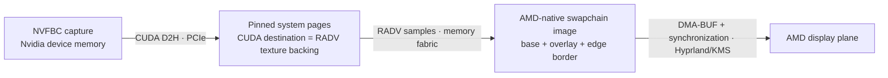

# A frame from Nvidia capture to AMD scanout

Waygriff captures a game on the RTX 5090 through NVFBC, copies its pixels once
into pinned system memory with CUDA, and samples those pages with the AMD iGPU.
RADV renders the final image into its own Wayland swapchain. Hyprland can put
that AMD-owned buffer directly on the display plane.

Direct scanout is verified on this machine. Lower end-to-end latency is **not**
yet demonstrated. These are separate results: removing an allocation restriction
does not remove every scheduling delay between capture and the display.
Measurements and the remaining work are tracked in `.deeds/8kxgv6.md`.

## Start with the bytes

A 3840 × 2160 BGRA frame contains 33,177,600 bytes, or 31.64 MiB. At 120 frames
per second, one complete transfer carries 3.98 GB/s. The refresh budget is
8.33 ms. Those numbers describe payload, excluding padding, metadata and other
memory traffic.

The discrete Nvidia GPU and the integrated AMD GPU do not share a local VRAM
heap. In the implemented path, CUDA moves the capture through Nvidia's PCIe
connection into system RAM. AMD reads it through its memory fabric. AMD's read
and output write still consume memory bandwidth; they are not a second trip
across Nvidia's PCIe link.

The initial transfer probe measured a 0.595 ms median for D2H plus completion
wait. The live application's `obtain_ms` is nearer 0.89 ms and includes buffer
selection as well. The probe used a synthetic device allocation; the application
uses NVFBC while the game and compositor run. They answer different questions.
The probe establishes feasibility, not an application latency promise.

## Why the old buffer could be composited but could not scan out

Previously, waygriff selected its Vulkan device by the CUDA device UUID. CUDA
copied into an Nvidia Vulkan image through opaque-fd interop, Nvidia rendered
the final frame, and Nvidia's Wayland implementation exported the result.

A DMA-BUF fd identifies shared backing storage. It does not, by itself, specify
how pixels are laid out, make every GPU understand that layout, or authorize
every display engine to scan out that allocation. Four separate questions
matter here: can AMD import the memory, can it interpret the pixels, can KMS
register a framebuffer, and can that framebuffer be used in the proposed atomic
display state?

The matching WSI probes in the [presentation-path investigation](../.deeds/closed/5jgf2q.md)
measured the following. Each used the application's format, extent, usage and
Mailbox mode; neither mapped a window or committed a display configuration.

| Exported property | Nvidia WSI | RADV WSI |
|---|---|---|
| DRM pixel format | XR24 / XRGB8888 | XR24 / XRGB8888 |
| Modifier | Linear, `0` | AMD tiled, `0x0200000000401b03` |
| Stride | 15,360 bytes | 15,360 bytes |
| Allocation size | 33,177,600 bytes | 33,423,360 bytes |
| AMD PRIME import | Succeeds | Succeeds |
| AMD GEM preferred domains | GTT (`0x2`) | GTT + VRAM (`0x6`) |
| AMD GEM flags | `0x200` | `0x28e` |
| KMS framebuffer registration | `EINVAL` | Succeeds |

XR24 describes channel storage; the modifier describes tiling or compression.
Neither describes the Vulkan sRGB sampling conversion. An opaque Vulkan
swapchain can export XRGB despite the application choosing a format with alpha.

The decisive restriction is allocation provenance. AMD's import code preserves
`AMDGPU_GEM_CREATE_CPU_GTT_USWC` from an AMD exporter, but not from an arbitrary
foreign exporter. The Nvidia import lacked this flag. AMD's display code permits
GTT scanout only under specific conditions including that flag. Without GTT
scanout eligibility, a foreign imported allocation cannot simply be migrated
into AMD VRAM to satisfy framebuffer creation, so registration fails.
See [AMD import](https://github.com/gregkh/linux/blob/v7.2.6/drivers/gpu/drm/amd/amdgpu/amdgpu_dma_buf.c#L415-L444),
[permitted scanout domains](https://github.com/gregkh/linux/blob/v7.2.6/drivers/gpu/drm/amd/amdgpu/amdgpu_display.c#L557-L578),
and [framebuffer validation](https://github.com/gregkh/linux/blob/v7.2.6/drivers/gpu/drm/amd/amdgpu/amdgpu_display.c#L1300-L1337).

GTT means system memory accessible through the GPU's address translation. VRAM
is the driver's GPU-local memory domain. These domain names are allocation and
placement rules; on an integrated GPU they should not be read as proof of a
physically separate bank of graphics memory. Likewise, the USWC allocation flag
is a kernel prerequisite here, not an application hint that can repair a foreign
import after the fact.

The primary plane advertised the linear modifier, so blaming the rejection on
linear pixels alone would be wrong. AMD could sample the Nvidia export for
composition. It could not register that same allocation as a framebuffer.

The Nvidia export was system-memory-backed, not evidence of AMD reading an
optimal-tiled Nvidia VRAM image. The probe observed NVKMS memory import followed
by PRIME export; Nvidia's kernel path supplies exportable scatter/gather pages
from non-vidmem allocations. See the
[595.99.02 NVKMS GEM implementation](https://github.com/NVIDIA/open-gpu-kernel-modules/blob/595.99.02/kernel-open/nvidia-drm/nvidia-drm-gem-nvkms-memory.c#L298-L378).
The proprietary Vulkan implementation remains a boundary of this investigation:
an internal transfer to shareable memory is a plausible model, but its exact
copy count and intermediate allocations were not traced.

## Give CUDA and RADV the same input pages

`src/source/nvfbc/host.rs` creates the pages before either API imports them.
This avoids assuming that CUDA can register an arbitrary pointer returned by
a Vulkan allocation. CUDA registers the allocation for device access; Vulkan
imports it using `HOST_ALLOCATION_BIT_EXT`. No CPU pixel memcpy sits between
CUDA's destination and RADV's input.

The allocation obeys both the image's memory requirements and the device's
`minImportedHostPointerAlignment`. The memory type must be compatible with both
the image and `vkGetMemoryHostPointerPropertiesEXT`. Waygriff requires coherent,
host-visible memory, and queries the linear image's row pitch and offset rather
than assuming tightly packed rows. On the tested RADV device those were memory
type 5, 4096-byte host alignment, row pitch 15360 and offset zero.
These are observed values, not portable constants. The
[host-memory extension](https://docs.vulkan.org/refpages/latest/refpages/source/VK_EXT_external_memory_host.html)
defines the import, alignment and lifetime rules.

Vulkano 0.35 does not expose this import through `MemoryImportInfo`. The small
host allocator therefore calls Vulkan's allocation/binding functions directly
and wraps the image with `assume_bound()`. Its owner retains the raw memory
handle and registered pages. Image references alone do not own that allocation;
the capture-slot owner must remain alive alongside them.

The imported image is linear `B8G8R8A8_SRGB`. Sampling decodes sRGB and writing
the sRGB swapchain encodes it again, preserving the established color path and
linear-light overlay blending. The screenshot shader samples the same input and
encodes its PNG bytes. Screenshots from `waygriffctl snap` show the source frame,
not the composited overlay or border.

External-memory images must be created in `Undefined` layout. Using
`Preinitialized` to preserve host contents would violate
[VUID-VkImageCreateInfo-pNext-01443](https://docs.vulkan.org/refpages/latest/refpages/source/VkImageCreateInfo.html).
Waygriff transitions each slot to `General` once, **before its first CUDA write**,
and retains that layout for host writes, rendering and screenshots. A later
transition from `Undefined` could discard the pixels just captured.

## Synchronization is part of the allocation design

The capture thread issues `cuMemcpy2DAsync` into the imported image's host pages,
using the queried destination pitch, then synchronizes the CUDA stream. NVFBC's
source pointer is valid only until the next grab, so that wait protects both
the source lifetime and publication of complete pixels. Registration and the
copy operation are documented in the
[CUDA Driver memory API](https://docs.nvidia.com/cuda/cuda-driver-api/group__CUDA__MEM.html).

After publication, a host-write-to-shader-read barrier orders AMD's access.
Coherence eliminates explicit mapped-memory cache flushes; it does not authorize
CUDA to overwrite pages while AMD is still reading them. The renderer retains
each capture slot until its submission fence completes, and also retains its
current frame for maintenance redraws and screenshots. Replaced pending frames
return directly to the pool. Capture remains a single replaceable slot rather
than a queue of old frames.

There is no cross-vendor CUDA/Vulkan external semaphore in this design. The
CPU completion wait supplies the handoff. The host image also has no foreign
Vulkan queue owner to release or acquire; Wayland DMA-BUF inputs and overlays
retain their external-ownership barriers.

Raw Vulkano command recording does not retain descriptor sets. The renderer
therefore keeps descriptors with its in-flight frames until the fence completes.
On shutdown it waits for GPU idle before dropping resources. The destruction
order is image, Vulkan memory, CUDA host registration, then pages. These are
correctness requirements even when the display appears to work without them.

## The output is a different allocation

The host capture image is an input texture. The output remains an ordinary
AMD-native WSI allocation, whose placement and modifier RADV negotiates with
Wayland. Importing host pages successfully is not itself proof that those pages
can be displayed directly. Separating input and output lets each allocation
satisfy its own constraints.

Hyprland's `direct_scanout=2` additionally requires a fullscreen game surface.
Waygriff sets `wp_content_type_v1` to `game` on the NVFBC path. Eligibility also
requires matching output pixel size and transform, an opaque solitary surface,
and no incompatible composition requirement. Fractional scale 1.25 works here:
the logical window is 3072 × 1728 while its buffer matches the 3840 × 2160 output.
See [Hyprland's eligibility and commit path](https://github.com/hyprwm/Hyprland/blob/efb50993780079460b0cbed1363e2166a2de1d9f/src/output/Monitor.cpp#L2016-L2223).

The Vulkan render-finished semaphore gates WSI presentation. WSI attaches
DRM-syncobj acquire and release timeline points to each Wayland buffer commit.
Hyprland waits for acquisition before making a surface state current; the buffer
cannot be reused until its release is signaled. A render fence completing does
not mean the image has reached the display. See
[surface-state acquisition](https://github.com/hyprwm/Hyprland/blob/efb50993780079460b0cbed1363e2166a2de1d9f/src/protocols/core/Compositor.cpp#L570-L615).

In live checks, `directScanoutTo` names waygriff and presentation flags are 15:
VSYNC, HW_CLOCK, HW_COMPLETION and ZERO_COPY. `zero_copy_fraction=1` means the
compositor did not copy these output buffers. CUDA D2H and AMD's rendering work
still happened. Null eligibility blockers alone are weaker evidence: framebuffer
registration or the atomic commit can still fail after eligibility passes.

## Why performance measurements still matter

The old unconfined border shaded a full-viewport triangle with blending enabled:
8.29 million fragment positions at 4K. Temporary GPU timestamps put its added
cost around 0.5–0.7 ms on this iGPU. Four nonoverlapping 25-pixel scissor strips
now cover at most 297,500 pixels, including corners only once. The shader's
breathing width and alpha remain unchanged. The isolated strip pass measured
about 0.03–0.04 ms. Normal play is confined and skips the border entirely.

Direct sampling of the host image took roughly 3.8–4.2 ms of GPU execution
without the border. An experimental dedicated SDMA upload reduced upload plus
confined graphics work to roughly 1.3 ms, but required RADV's experimental
transfer-queue exposure and did not establish lower presentation latency. It
was removed, along with its buffer aliases, second queue and timing probes.
The retained implementation uses the simpler sampling path.

The faster experiment still reported roughly 13–18 ms source-to-presentation
in short confined windows. Waiting for GPU completion before calling present
did not cure it. A Wayland trace showed a ready commit receiving its frame
callback at one refresh and its presentation feedback at the following refresh.
This is evidence of delay beyond the measured draw; it does not identify the
exact atomic-commit or kernel scheduling boundary. Faster GPU execution alone
is not an end-to-end latency result.

Source and destination clocks drift relative to each other. Two short samples
can differ by several milliseconds without a code change, and a missed deadline
adds an entire 8.33 ms period. Use confined headline measurements, pair an
unconfined run to expose border cost, check feedback freshness, and record
Hyprland's monitor state and modeset-log delta around each interval. The earlier
failed-scanout modeset storm made otherwise plausible comparisons misleading.
Timing boundaries are defined in [latency.md](latency.md).

The observations above used RTX 5090 / Nvidia 595.99.02, Ryzen 9 9950X3D
RADV RAPHAEL_MENDOCINO / Mesa 26.2.2, Linux 7.2.6 and Hyprland v0.56.2 at
`efb50993780079460b0cbed1363e2166a2de1d9f`. Kernel and compositor links are pinned
to those versions. The Vulkan and CUDA references describe API requirements;
the probe and application results establish what this particular machine did.
