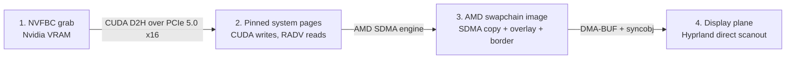

# A frame from Nvidia capture to AMD scanout

The game renders on an RTX 5090 driving X display `:80`. The desktop is a
Hyprland session on the Ryzen's integrated AMD GPU, which owns the monitor.
Waygriff's job is to move each game frame from the first GPU to the second and
get it onto the screen with as little delay as possible.

This document follows one frame along that route and explains, at each hop, what
physically happens, what the kernel and drivers allow, and why the current
design takes the path it does. The last sections cover synchronization, pacing
and the measured result. Source links are pinned to the versions on the machine:
Nvidia 595.99.02, Mesa 26.2.2, Linux 7.2.6, Hyprland v0.56.2.

## The route



| Hop | Engine doing the work | Measured cost |
|---|---|---:|
| NVFBC grab + CUDA copy to host | Nvidia copy engine | ~0.9 ms (`obtain_ms`) |
| SDMA upload + overlay/border draw | AMD SDMA, then AMD graphics | ~1.3 ms GPU time |
| Commit to Hyprland → pixels on the wire | KMS page flip | ~5 ms (`submit_to_present_ms`) |

A 3840×2160 BGRA frame is 33,177,600 bytes (31.6 MiB). At 120 frames per
second that is 4 GB/s of payload per hop, against a refresh period of 8.33 ms.
The two GPUs have no shared local memory: the RTX 5090 has its own VRAM behind
PCIe, the iGPU shares the CPU's DRAM. Every frame therefore crosses PCIe exactly
once, into system RAM. Everything after that stays on the AMD side of the
memory controller.

## Hop 1: out of Nvidia VRAM

NVFBC hands back a CUDA device pointer into a capture buffer in Nvidia VRAM.
That buffer is only valid until the next grab, so the pixels have to leave
before the capture thread asks for another frame.

The destination is pinned system memory. A GPU DMA engine writes to physical
addresses, so the pages must be locked in RAM and their physical layout known
to the driver. Waygriff allocates the pages itself and registers them with
`cuMemHostRegister`; the Nvidia driver pins them and builds the scatter/gather
list its copy engine needs. `cuMemcpy2DAsync` (device to host, with the
destination pitch matching the Vulkan image's row pitch) then streams the frame
across the PCIe 5.0 x16 link. The capture thread synchronizes the CUDA stream
before publishing the frame, which is the moment the pixels are guaranteed to
be in RAM. See the
[CUDA driver memory API](https://docs.nvidia.com/cuda/cuda-driver-api/group__CUDA__MEM.html).

Cost: a synthetic probe measured 0.6 ms median for copy plus completion wait;
inside the running application `obtain_ms` is about 0.9 ms, which includes slot
selection and runs while the game and compositor compete for the link and the
memory bus.

## Hop 2: the same pages, seen by RADV

The trick that makes the design cheap is that CUDA's destination pages *are*
RADV's source. There is no CPU memcpy between the two drivers.

`VK_EXT_external_memory_host` lets a Vulkan implementation import an existing
host pointer as `VkDeviceMemory`
([extension reference](https://docs.vulkan.org/refpages/latest/refpages/source/VK_EXT_external_memory_host.html)).
`src/source/nvfbc/host.rs` does this for each capture slot:

1. Create a linear `B8G8R8A8_SRGB` image and a transfer-source buffer, both
   flagged for host-allocation import, and query their memory requirements.
2. Allocate pages satisfying both resources' size and alignment, plus RADV's
   `minImportedHostPointerAlignment` (4096 bytes here). Registering them with
   CUDA happens on these pages, before Vulkan sees them.
3. Ask `vkGetMemoryHostPointerPropertiesEXT` which memory types can hold the
   pointer, intersect with the two resources' requirements, and pick a
   host-visible, host-coherent type (type 5 on this device, a GTT type; the
   pages stay ordinary cached system memory).
4. Import with `VkImportMemoryHostPointerInfoEXT`, bind image and buffer to the
   same memory at offset 0.

The image and buffer alias the same bytes. The image is what the scaled path
samples and what the screenshot shader reads; the buffer is what SDMA copies
from on the unscaled path. Both readers use the row pitch reported by
`vkGetImageSubresourceLayout` (15360 bytes, i.e. tightly packed) rather than
assuming it. Vulkan guarantees a consistent view between a buffer and a linear
image in `General` layout
([memory aliasing rules](https://docs.vulkan.org/spec/latest/chapters/resources.html#resources-memory-aliasing)).

One wrinkle: an image importing external memory must be created in `Undefined`
layout, not `Preinitialized`
([VUID-VkImageCreateInfo-pNext-01443](https://docs.vulkan.org/refpages/latest/refpages/source/VkImageCreateInfo.html)).
A transition out of `Undefined` may discard contents. Waygriff therefore
transitions each slot to `General` once, before CUDA ever writes to it, and
leaves it there for good.

Vulkano 0.35 has no host-pointer variant of `MemoryImportInfo`, so this file
calls `vkAllocateMemory` and the bind functions directly and wraps the results
with `assume_bound()`. The consequence is that the image and buffer objects do
not own their memory; the `Buffer` struct in host.rs does, and it must outlive
every reference to them. Its drop order is image and buffer, then Vulkan memory,
then CUDA unregistration, then the pages.

## Hop 3: into an AMD-native swapchain image

The output image is an ordinary RADV WSI swapchain image, allocated by RADV
and negotiated with Hyprland through linux-dmabuf. It is tiled (modifier
`0x0200000000401b03`) and lives in the GPU's preferred domain. Hop 4 explains
why the output must be AMD's own allocation; this section is about filling it.

Two ways to fill it were measured on the iGPU at 4K:

| Method | GPU time, no border |
|---|---:|
| Fragment shader sampling the linear host image | 3.8–4.2 ms |
| SDMA copy from the buffer alias | ~1.3 ms including overlay/border pass |

SDMA is AMD's dedicated DMA engine. It understands the tiled layout of the
destination, reads the linear source from system memory, and leaves the
shader cores idle. The frame is sRGB bytes in and sRGB bytes out, so the copy
is exact. Sampling stays in use for the scaled path (window smaller than the
source) and for Wayland capture backends, and decodes/re-encodes sRGB through
the shader as before.

Reaching SDMA from Vulkan requires a queue family with `TRANSFER` but neither
`GRAPHICS` nor `COMPUTE`. Mesa 26.2.2 only exposes one behind
`RADV_EXPERIMENTAL=transfer_queue`
([eligibility check](https://gitlab.freedesktop.org/mesa/mesa/-/blob/mesa-26.2.2/src/amd/vulkan/radv_physical_device.c#L109-123),
[env var docs](https://docs.mesa3d.org/envvars.html#radv-driver-environment-variables)).
`lib.rs` sets that variable before creating any thread or Vulkan object. If the
queue is missing, the copy runs on the graphics queue and the deadline pacing
described later is disabled; nothing breaks, it is just slower.

Per frame, with the queue available:

1. Acquire a swapchain image (binary semaphore A).
2. Transfer queue: wait A, barrier host-write → transfer-read, copy buffer to
   image, transition to `ColorAttachmentOptimal`, signal semaphore U.
3. Graphics queue: wait U, load the attachment, draw the overlay (alpha
   blended) and, when unconfined, the border strips; signal the present
   semaphore and the frame's fence.
4. `vkQueuePresentKHR`.

The swapchain is created with concurrent sharing between the two families, so
no queue ownership transfers are needed. The graphics fence covers the SDMA
work transitively because graphics waited on U.

The border is worth a note because it was the largest single GPU cost before
this work. Drawn as a full-screen blended triangle it touched 8.3 million
fragments and cost 0.5–0.7 ms. It is now four disjoint 25-pixel scissor
rectangles along the edges (about 300,000 pixels, 0.03–0.04 ms), with the same
breathing animation. During normal play the window is confined and the border
is not drawn at all.

## Hop 4: why the output had to be AMD's own allocation

The first version of waygriff did the natural thing: pick the Nvidia Vulkan
device, render there, and let Nvidia's Wayland WSI hand the finished buffer to
Hyprland. Hyprland could composite it, but it ran at 40–55 Hz with 30 ms of
latency. Understanding why is the "kernel politics" part of the tour.

A DMA-BUF is a kernel handle to shared backing memory. Passing one from Nvidia
to AMD raises four separate questions, each answered by different code:

1. Can amdgpu import the memory? (PRIME import)
2. Can it interpret the pixels? (DRM format and modifier)
3. Will KMS accept it as a framebuffer? (`drmModeAddFB2WithModifiers`)
4. Will the atomic commit using that framebuffer succeed?

Probes with the application's exact swapchain parameters gave these answers:

| Exported property | Nvidia WSI | RADV WSI |
|---|---|---|
| DRM pixel format | XR24 / XRGB8888 | XR24 / XRGB8888 |
| Modifier | Linear (`0`) | AMD tiled (`0x0200000000401b03`) |
| Stride | 15,360 bytes | 15,360 bytes |
| Allocation size | 33,177,600 bytes | 33,423,360 bytes |
| amdgpu PRIME import | Succeeds | Succeeds |
| GEM preferred domains | GTT (`0x2`) | GTT + VRAM (`0x6`) |
| GEM create flags | `0x200` | `0x28e` |
| KMS framebuffer registration | `EINVAL` | Succeeds |

Questions 1 and 2 pass: the Nvidia export is linear system memory, amdgpu can
map it into its address space and read it. That is why compositing worked.
Question 3 fails, and the reason is allocation provenance rather than pixel
layout. amdgpu's display code allows scanout from GTT (system memory) only for
buffers created with `AMDGPU_GEM_CREATE_CPU_GTT_USWC`
([permitted scanout domains](https://github.com/gregkh/linux/blob/v7.2.6/drivers/gpu/drm/amd/amdgpu/amdgpu_display.c#L557-L578)).
The PRIME import path preserves that flag when the exporter is another amdgpu
device, and leaves it clear for a foreign exporter
([import](https://github.com/gregkh/linux/blob/v7.2.6/drivers/gpu/drm/amd/amdgpu/amdgpu_dma_buf.c#L415-L444)).
Framebuffer validation then rejects the buffer
([validation](https://github.com/gregkh/linux/blob/v7.2.6/drivers/gpu/drm/amd/amdgpu/amdgpu_display.c#L1300-L1337)),
and since a foreign import cannot be migrated into VRAM, there is no fallback.
The primary plane does advertise the linear modifier, so linearity alone is not
the problem. No userspace flag can fix this after the fact: the decision is
made at allocation time by whichever driver allocated.

On the Nvidia side, the exported buffer is not the game's VRAM render target.
The proprietary Vulkan driver presents through NVKMS memory that its DRM layer
can export as scatter/gather pages
([595.99.02 NVKMS GEM implementation](https://github.com/NVIDIA/open-gpu-kernel-modules/blob/595.99.02/kernel-open/nvidia-drm/nvidia-drm-gem-nvkms-memory.c#L298-L378)).
What happens between the render target and that export inside the closed
driver was not traced; at minimum it is one more copy that waygriff no longer
pays.

The failure of question 3 also had a second-order cost. Hyprland retried
direct scanout every frame, the rollback after each failed attempt marked the
output format as changed, and that forced a blocking modeset per frame. That
bug and its `direct_scanout = 2` workaround are written up in
[`.deeds/closed/5jgf2q.md`](../.deeds/closed/5jgf2q.md).

So the output image is allocated by RADV. The Nvidia pixels enter it through
system memory (hops 1–3), and from Hyprland's point of view waygriff is just
another AMD Vulkan client.

## Hop 5: direct scanout in Hyprland

With `render:direct_scanout = 2` (auto), Hyprland puts a client's buffer
straight on the display plane, skipping its own composition pass, when the
surface is fullscreen, solitary, opaque, matches the output's pixel size and
transform, and declares content type `game`
([eligibility and commit path](https://github.com/hyprwm/Hyprland/blob/efb50993780079460b0cbed1363e2166a2de1d9f/src/output/Monitor.cpp#L2016-L2223)).
Waygriff sets `wp_content_type_v1` to `game` on the NVFBC path. Fractional
scale 1.25 is not an obstacle: the logical window is 3072×1728 but the buffer
is 3840×2160, which is what the check compares.

RADV's WSI attaches DRM-syncobj acquire and release timeline points to each
buffer commit. Hyprland waits on the acquire point before it will use the
buffer and signals the release point when KMS is done with it
([surface-state acquisition](https://github.com/hyprwm/Hyprland/blob/efb50993780079460b0cbed1363e2166a2de1d9f/src/protocols/core/Compositor.cpp#L570-L615)).
The render-finished semaphore feeds the acquire point; a completed fence on the
client side says nothing about when the pixels reach the display.

Evidence that the path is engaged: `hyprctl monitors` reports
`directScanoutTo` as waygriff, and presentation feedback carries flags 15
(VSYNC, HW_CLOCK, HW_COMPLETION, ZERO_COPY). `zero_copy_fraction = 1` in
`waygriffctl stats` means Hyprland never copied an output buffer. Note that
`directScanoutBlockedBy: null` alone is weak evidence, since framebuffer
registration or the atomic commit can still fail after eligibility passes.

## Synchronization, end to end

Who waits for whom, in order:

- **CUDA stream sync** on the capture thread: the frame is in RAM before it is
  published. This is the only Nvidia→AMD handoff; there is no cross-vendor
  semaphore, and none is needed because the CPU wait is on the critical path
  anyway.
- **Host-write → transfer-read (or shader-read) barrier** on the AMD queue:
  orders the GPU's reads after the publication. Coherent memory makes cache
  flushes unnecessary.
- **Semaphore U**: SDMA before graphics.
- **Present semaphore → syncobj acquire point**: graphics before KMS.
- **Per-frame fence**: gates reuse of the in-flight slot. The renderer keeps
  the capture slot, its descriptor sets and the command buffers alive until
  the fence signals, then the slot returns to the capture pool. This is what
  stops CUDA from overwriting pages the iGPU is still reading.
- **Device idle on shutdown**, then the drop order from hop 2.

The capture side holds one replaceable pending slot. A frame that is replaced
before the renderer takes it goes straight back to the pool; there is no queue
of stale frames.

## Pacing: why faster rendering alone did not lower latency

After hops 1–3 were in place, GPU time per frame had dropped from ~4 ms to
~1.3 ms, but the submit-to-present time was still over 12 ms. The remaining
delay was in the compositor's page-flip schedule, not in waygriff.

Aquamarine's frame scheduler allows one pending page flip per output
([FrameScheduler.cpp](https://github.com/hyprwm/aquamarine/blob/1a10fe26a9f7d989c359e6a9ea61aa2e44d06c36/src/backend/FrameScheduler.cpp#L5-L26)).
A buffer that becomes ready while a flip is pending is picked up only after
that flip completes, and shown on the refresh after that. With waygriff
submitting whenever a capture landed, frames routinely arrived one flip too
early and waited a full period.

A client-side trace confirmed where the time went: it imported WSI's exported
syncobj timelines and waited on the acquire points without altering them.
Over 7,741 frames the acquire point was ready about 1.5 ms after commit.
Ready-to-presentation then averaged 12.5 ms with unrestricted submission and
6.4 ms when at most one presentation was outstanding.

The renderer now keeps one source presentation in flight. When presentation
feedback for it arrives, on `CLOCK_MONOTONIC` with a refresh period, the next
render deadline is:

```
last presentation + refresh period − 5 ms
```

The capture thread keeps replacing the pending slot until then; at the deadline
the renderer takes whatever is newest. The 5 ms budget covers ~1.3 ms of GPU
work plus CPU, WSI and compositor scheduling on this machine. It is a constant
tuned for this iGPU at 4K@120 (deeds issue k9hved covers trimming it). It
only applies on the SDMA path; the sampled path, missing or non-monotonic
feedback, and composition all fall back to submit-on-arrival.

Two alternatives were tried and rejected. Requiring a capture newer than the
last presentation could throw away the only frame able to meet the next
deadline and halved cadence at some source/output phases. Free-running
deadlines without the one-in-flight limit restored cadence but re-queued the
extra refresh.

A 50 ms maintenance redraw remains underneath all of this so that resize,
capture toggles and a static source keep working when feedback stops (for
example while the window is hidden).

## Measured result

Same HoN menu at 3840×2160@120, about 243 s per interval, means of 5-second
snapshots excluding the first 10 s, each covering the last 600 displayed
frames. Intervals are long enough to span the source/output phase drift.

| Path / state | Displayed Hz | Total ms | Submit→present ms | Obtain ms | ZERO_COPY |
|---|---:|---:|---:|---:|---:|
| Nvidia render, composited (c8e1455f), confined | 118.5 | 14.0 | 13.4 | 0.36 | 0 |
| AMD SDMA + pacing, confined | 118.9 | 10.1 | 5.0 | 0.97 | 1 |
| AMD SDMA + pacing, unconfined (border strips) | 118.1 | 10.2 | 5.1 | 0.99 | 1 |

"Total" is `present_ms` from `docs/latency.md`: age of the capture at grab,
plus grab-to-submit, plus submit-to-present. All intervals kept the same
monitor mode with zero modeset-log growth.

How to read the numbers:

- Submit→present sits at 5 ms by construction: it is the render-ahead budget.
  The remaining ~5 ms is capture age plus the wait for the deadline.
- The source and output clocks drift in phase, so the rolling total moved
  between 6.2 and 14.2 ms within the confined interval while submit→present
  stayed within 5.0–5.2. Short measurement windows are not comparable to each
  other; the 4-minute mean is.
- A missed deadline costs a whole 8.33 ms period on that frame. The mean is not
  a per-frame bound.
- Confined vs unconfined differs by too little to attribute to the border;
  the border's cost is established by the isolated GPU timings in hop 3.

Measurement discipline, learned the hard way: confine before taking headline
numbers, pair one unconfined run when rendering changes, check that
presentation feedback is fresh (hyprlock silently stops it), and record
`hyprctl monitors` plus the Hyprland modeset-log count around each interval.
Timing boundaries are defined in [latency.md](latency.md).

Hardware for all of the above: RTX 5090 (PCIe 5.0 x16) with driver 595.99.02,
Ryzen 9 9950X3D iGPU (RADV RAPHAEL_MENDOCINO) with Mesa 26.2.2, Linux 7.2.6,
Hyprland v0.56.2 at `efb50993`, monitor HDMI-A-1 at 3840×2160@120.
